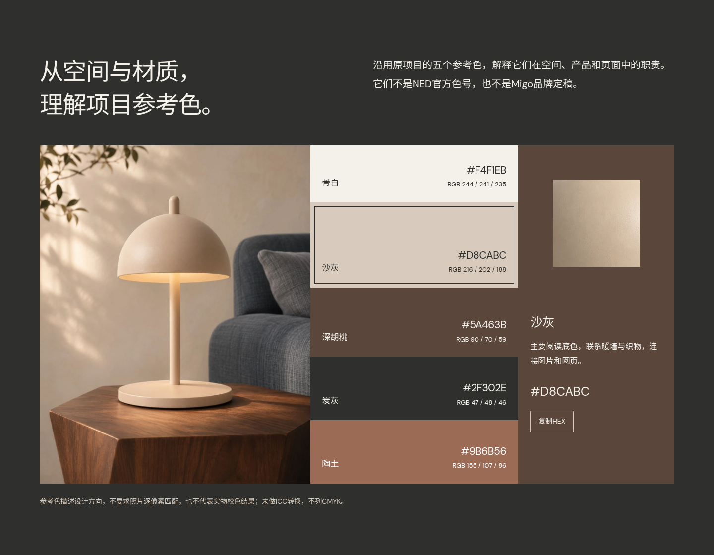

# NED网页展示V02｜规划与可操作样稿

日期：2026-11-15。状态：候选，待Migo审阅；本次按用户要求随V01纳入GitHub归档提交，未部署。保留[V01](../V01/README.md)及全部原作品；[两版入口](../README.md)。本轮只深化NED详情，不替代整站最终UI。

## 从这里查看

| 交付 | 入口 |
| --- | --- |
| 可操作的单文件HTML | [展示样稿.html](展示样稿.html) |
| 设计规划与验收任务表 | [设计规划.md](设计规划.md) |
| 桌面／手机完整页面 | [桌面](预览图/完整页面_桌面.png) · [手机](预览图/完整页面_手机.png) |
| 重点优化区域 | [背景介绍](预览图/项目背景_桌面.png) · [设计策略](预览图/设计策略_桌面.png) · [项目参考色](预览图/项目参考色_桌面.png) |
| Skill执行与实际结果 | [执行记录](执行记录.md) · [独立完成审阅](独立审阅记录.md) |
| 事实与视觉候选规则 | [PRODUCT.md](PRODUCT.md) · [DESIGN.md](DESIGN.md) |
| 浏览器及来源证据 | [检查记录](检查记录.json) · [动效／弱网／真实像素专项](运行记录/专项检查.json) · [素材来源](素材来源.json) · [字体记录](字体记录.json) |

## 与V01的变化

- **背景更具体**：任务、需要解决的信息问题、本人判断与AI执行分开表达，保留自主模拟的真实边界。
- **策略更可追溯**：昼夜层次、产品识别、内容职责分别对应已有场景与成果，使用“依据—选择—证据”组织。
- **作品与页面共同形成氛围**：沙灰连接阅读，深胡桃承接背景与A+，炭灰支撑色谱和收尾，陶土用于识别策略。原商品图的浅色背景属于作品，完整保留。
- **参考色成为可读内容**：场景、非等高五色和材质并置；HEX／RGB与用途为网页文字，可选择、可复制，手机自然堆叠。借鉴用户参考图的方法，没有复制其配色、照片、比例或数值。

五色来自NED原项目规划，不是NED官方VI、实物色号或Migo最终品牌色。DM Sans延续原作品，Noto Sans SC是本次中文网页候选。后续Migo VI通过网站与案例变量分层接入，仍须复查字号、对比和角色尺度。

## 怎么操作

1. 打开HTML，使用“项目背景”“设计策略”“查看完整成果”进入相应章节。
2. 切换暮色／夜间，比较局部暖光与环境层次。
3. 点按五色色块查看用途，复制HEX；剪贴板不可用时可选择色号手动复制。
4. 点按8张商品图放大，用按钮或左右方向键切换，Esc关闭并返回原焦点。
5. 右上角切换中文／英文。英文为结构与表达审阅草稿。

单文件内嵌图片、字体、样式、交互与本轮使用的官方动效模块，离开仓库不依赖素材相对路径。已在只有该文件的空目录通过HTTP验证。当前测试环境的浏览器禁止file协议，未将“双击已通过”列为验证结果。也可在本目录启动本地HTTP服务，访问开发入口index.html；后者依赖旁边的assets和制作资料。

源码入口按屏幕与cover裁切后的有效像素选取真实响应式资源；便携文件移除多余候选，保留清晰单版本。两者的作用不同，完整原图入口均保留。

GitHub代码页展示HTML源码，不直接运行页面。本轮没有修改线上Pages；在线第三版仍是原线框预览。

## 检查与执行边界

14种布局（中文／英文，1440、2048、1024、820、768、390、320宽）检查通过，无破图、横向溢出、文字溢出或章节互相覆盖。已检查场景、五色、复制回退、8图浏览、键盘焦点、模拟触控、减少动态效果与无JS阅读。5个原始成果／规划外链均返回200。

专项另测正常图片显影、reduce静态状态及手机冷启动的实际图片物理尺寸；所测cover图没有实际像素放大。在1.6Mbit/s、150ms延迟模拟下，跳转1秒后商品区4／4张可见图、A+区2／2张可见图已加载。这仅覆盖所测情境，不代表真实设备或所有网络条件。

这次实际启动了taste-skill与Impeccable的适用流程，包含官方命令、独立完成审阅与设计规则提取。官方性能交付版0 FAIL、2个字体体积WARN；taste完成gate为OPEN 63，固定整屏等规则尚未全部满足，不能写成全部自动门禁通过。原始结果、实际修复、取舍及未验证项在执行记录中逐项说明。

独立审阅者将其提出的方向契约修复判为resolved，并给出局部ship；没有独立重测英文与所有交互，不代表用户已验收。

## 内容范围

保留8张完整商品图；A+、故事与Banner有真实代表素材、网页说明和完整原稿入口。没有把代表章节记为10个桌面A+模块、11个手机状态、故事四卡及六份Banner适配全部重制完成，也没有虚构委托、上架、投放或效果数据。

主要待审阅：背景是否准确表达本人目标；三项策略是否清楚；配色区是否符合预期；NED局部氛围的使用强度。下一轮再按反馈扩展完整成果与首页衔接。

## 文件与维护

- index.html是官方检查与维护入口，由制作资料中的中文模板、样式、交互和生成脚本形成。
- 展示样稿.html是便携交付，修改源码后重新生成，不直接改内嵌成品。
- assets保留本轮实际使用的图片、字体、官方样式／动效和许可证。WebP来源使用官方工具的同名JSON回退记录；完整映射集中在素材来源.json。
- PRODUCT.md／DESIGN.md及.impeccable为Skill识别资料，记录范围仅限本V02候选。
- .taste-skill与运行记录保存真实抽取、检查和门禁结果；临时浏览器档案及重复裁图不进入Git。

图片沿用AIGC已有AI辅助视觉与合成，不称实景摄影；未新增生成。taste-skill使用MIT许可，字体保留两份OFL，便携HTML也附许可证内容。源图及前期审阅版本未覆盖。
