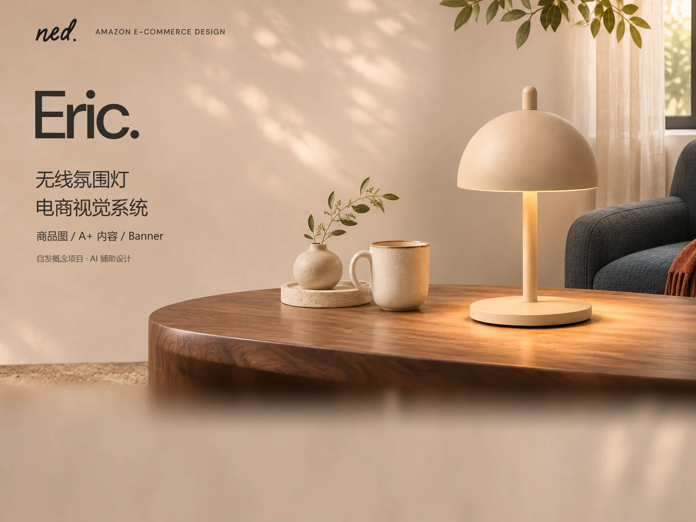

# NED封面｜网页导出试用

日期：2026-11-14。用户在了解素材检索与图片交付工具后要求“你直接帮我操作吧”；本次以[NED试验案例资料卡](../../../文档/首篇案例资料卡.md)已引用的封面V04进行一次实际导出。

## 本次交付

| 项目 | 结果 |
| --- | --- |
| 输入 | AIGC内封面V04的PNG原件，1600×1200，1,706,456字节 |
| 输出 | [封面WebP](01_NED_Eric_封面_V04_1600x1200.webp)，1600×1200，91,246字节，约91.25 KB |
| 体积变化 | 相比所用PNG减少94.65%；这是文件体积对比，不是实测网页加载提速 |
| 参数 | WebP有损质量85，长边上限1600；原图已是1600，因此未缩放、未裁切 |
| 色彩 | 按嵌入RGB ICC转换到sRGB；未重新调色或改变设计 |
| 追溯 | [交付清单](交付清单.json)记录源路径、原件及派生哈希、尺寸和处理参数 |
| 状态 | 网页导出试用，待用户看图确认；源设计与对外公开状态沿用资料卡，不因导出而终审 |

## 来源与工具

- 源仓库：`Migo1203/AIGC`，本次读取提交`4929b4063e74fd11642b6ff83c32f9f1f31deba1`。
- [固定版本原PNG](https://github.com/Migo1203/AIGC/blob/4929b4063e74fd11642b6ff83c32f9f1f31deba1/作品项目/NED_Eric_Lamp_氛围灯/制作交付/作品集展示/V04/01_NED_Eric_封面_V04_1600x1200.png)及[源版本说明](https://github.com/Migo1203/AIGC/blob/4929b4063e74fd11642b6ff83c32f9f1f31deba1/作品项目/NED_Eric_Lamp_氛围灯/制作交付/作品集展示/V04/README.md)。该源文件最近修改提交为`bf1832d`。
- 实际工具：[设计资源库图片交付脚本](https://github.com/Migo1203/design-resources/blob/a6093e53395ad309cea34bb9a83a97461ed5e227/素材与工具/工具/交付与检索脚本/图片交付.py)，版本`a6093e5`，Pillow 12.3.0。调用该脚本完成导出，没有另写一套图片处理程序。
- 文件验证：输出可完整解码，Chromium通过本地HTTP实际读取为1600×1200；尺寸／格式／SHA256与清单一致；导出前后原PNG哈希相同。
- 查看范围：实际查看完整原PNG及输出WebP，主要标题、中文说明、构图和灯具轮廓仍可辨识；尚未做逐像素审阅或真实设备验收。有损压缩不称为与原图完全相同。

该文件是NED案例内容的派生版本，不是Migo／Beedog品牌视觉资产，也不进入通用素材原件数量。初制时只在网站仓库本地准备；2026-11-15用户要求将本文件和相关试用记录推送GitHub，见[归档授权](../../../网站决策日志.md)。Pages发布来源仍保持第三版，不因归档而部署。

## 后续用途

2026-11-14，用户随后要求“帮我替换”，已在[封面接入试用稿](../../../线框/封面接入试用/README.md)中使用本文件，供首页、作品列表、详情及查看层复用。属于本地接入试验，未正式采用或部署；原件和本WebP均未再次改写。

待确认后，可用于详情页开篇的图片接入试验。网站布局尚未定稿；手机版本的尺寸、是否需要重新组织封面中的文字，以及后续`srcset`规格应结合实际版式确定，不自动把整张图缩到手机宽度作为最终阅读方案。
